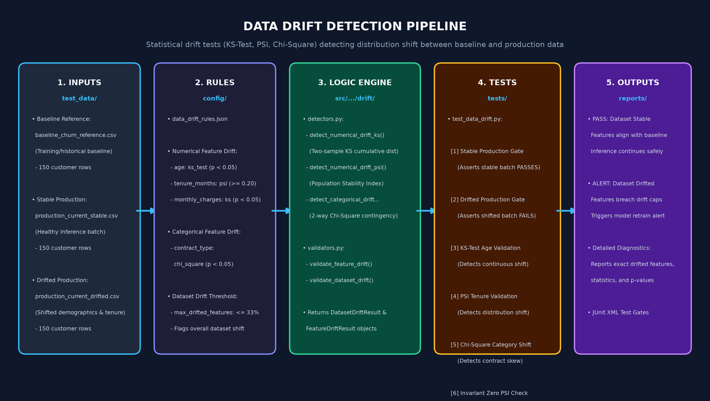

# Data Drift Detection

A statistical testing and observability module designed to detect feature distribution shifts between baseline training data and live production inference data before model accuracy decays.

---

## Architecture & Workflow

The Data Drift Detection pipeline evaluates features across 5 programmatic stages:



1. **Inputs:**
   - **Baseline Reference:** [`test_data/baseline_churn_reference.csv`](../../test_data/baseline_churn_reference.csv) (150 customer rows representing training distribution).
   - **Stable Production Data:** [`test_data/production_churn_current_stable.csv`](../../test_data/production_churn_current_stable.csv) (Healthy production inference batch).
   - **Drifted Production Data:** [`test_data/production_churn_current_drifted.csv`](../../test_data/production_churn_current_drifted.csv) (Shifted demographics and account profiles).
2. **Rules:** Drift detection methods and thresholds configured in [`config/data_drift_rules.json`](../../config/data_drift_rules.json).
3. **Logic:**
   - Statistical detection engine: [`src/ai_observability_qa/drift/detectors.py`](../../src/ai_observability_qa/drift/detectors.py)
   - Quality gates & aggregation: [`src/ai_observability_qa/drift/validators.py`](../../src/ai_observability_qa/drift/validators.py)
4. **Tests:** Automated test suite in [`tests/test_data_drift.py`](../../tests/test_data_drift.py).
5. **Outputs:** Detailed diagnostic reporting, JUnit XML test gates, and automated deployment alerts.

---

## Statistical Detection Methods

### 1. Kolmogorov-Smirnov (KS) Test (Numerical Features)
- **Function:** `detect_numerical_drift_ks(baseline, current, feature_name, p_value_threshold=0.05)`
- **Mechanism:** Two-sample test comparing empirical cumulative distribution functions (eCDF).
- **Decision Rule:** If $p\text{-value} < 0.05$, the null hypothesis (identical distributions) is rejected $\rightarrow$ **Drift Detected**.

### 2. Population Stability Index (PSI) (Continuous Features)
- **Function:** `detect_numerical_drift_psi(baseline, current, feature_name, psi_threshold=0.20)`
- **Formula:**
  $$\text{PSI} = \sum_{i=1}^{k} (P_i - B_i) \times \ln\left(\frac{P_i}{B_i}\right)$$
  *(where $B_i$ is baseline bin percentage, $P_i$ is production bin percentage)*
- **Benchmarks:**
  - $\text{PSI} < 0.10$: Stable / No significant change.
  - $0.10 \le \text{PSI} < 0.20$: Moderate shift (warning).
  - $\text{PSI} \ge 0.20$: Significant distribution drift (critical alert).

### 3. Chi-Square Test of Independence (Categorical Features)
- **Function:** `detect_categorical_drift_chisquare(baseline, current, feature_name, p_value_threshold=0.05)`
- **Mechanism:** Builds a $2 \times K$ contingency table comparing category frequencies between baseline and production samples using `scipy.stats.chi2_contingency`.
- **Decision Rule:** If $p\text{-value} < 0.05$, category distribution has shifted significantly $\rightarrow$ **Drift Detected**.

---

## Configured Rules (`config/data_drift_rules.json`)

```json
{
  "dataset_name": "customer_churn_drift_evaluation",
  "max_drifted_features_ratio": 0.33,
  "numerical_features": {
    "age": {
      "method": "ks_test",
      "threshold": 0.05
    },
    "tenure_months": {
      "method": "psi",
      "threshold": 0.20
    },
    "monthly_charges": {
      "method": "ks_test",
      "threshold": 0.05
    }
  },
  "categorical_features": {
    "contract_type": {
      "method": "chi_square",
      "threshold": 0.05
    }
  }
}
```

---

## Dataset-Level Quality Gate

The framework does not merely evaluate features in isolation; it checks overall dataset integrity:

- Computes the proportion of drifted features:
  $$\text{Drift Share} = \frac{\text{Drifted Features Count}}{\text{Total Features Tested}}$$
- If $\text{Drift Share} > 0.33$ (over 33% of features drifted), the dataset gate triggers:
  `dataset_drift_detected = True`
- Triggers operational alerts to retrain the model or inspect data upstream.

---

## How to Run Tests

```bash
# Run only data drift detection tests
pytest tests/test_data_drift.py -v

# Run with JUnit XML reporting
python -m pytest tests/test_data_drift.py --junitxml=reports/data-drift-results.xml
```

