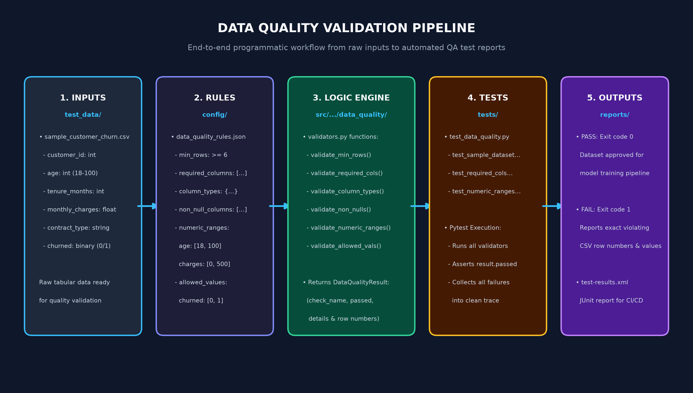

# Data Quality Testing

A modular validation suite for tabular datasets in AI/ML systems, verifying schema integrity, null constraints, numeric bounds, and category sets before training or inference.

---

## Architecture & Workflow

The Data Quality testing pipeline evaluates datasets across 5 programmatic stages:



1. **Inputs:** Raw tabular CSV data from [`test_data/sample_customer_churn.csv`](../../test_data/sample_customer_churn.csv).
2. **Rules:** Expectation definitions from [`config/data_quality_rules.json`](../../config/data_quality_rules.json).
3. **Logic:** Pure validation functions in [`src/ai_observability_qa/data_quality/validators.py`](../../src/ai_observability_qa/data_quality/validators.py).
4. **Tests:** Automated test suite in [`tests/test_data_quality.py`](../../tests/test_data_quality.py).
5. **Outputs:** Terminal assertion traces with exact row numbers and JUnit XML ([`reports/test-results.xml`](../../reports/test-results.xml)).

---

## Configured Expectations (`config/data_quality_rules.json`)

```json
{
  "dataset": "sample_customer_churn",
  "min_rows": 6,
  "required_columns": [
    "customer_id", "age", "tenure_months", "monthly_charges", "contract_type", "churned"
  ],
  "column_types": {
    "customer_id": "int64",
    "age": "int64",
    "tenure_months": "int64",
    "monthly_charges": "float64",
    "contract_type": "object",
    "churned": "int64"
  },
  "non_null_columns": [
    "customer_id", "age", "tenure_months", "monthly_charges", "contract_type", "churned"
  ],
  "numeric_ranges": {
    "age": { "min": 18, "max": 100 },
    "tenure_months": { "min": 0, "max": 120 },
    "monthly_charges": { "min": 0, "max": 500 },
    "churned": { "min": 0, "max": 1 }
  },
  "allowed_values": {
    "contract_type": ["month-to-month", "one-year", "two-year"],
    "churned": [0, 1]
  }
}
```

---

## Validation Logic (`validators.py`)

Each validator function returns a frozen `DataQualityResult` dataclass:

```python
@dataclass(frozen=True)
class DataQualityResult:
    check_name: str
    passed: bool
    details: str
```

### Supported Validation Functions:

- `validate_min_rows(dataframe, min_rows)`: Ensures dataset row count meets volume expectations.
- `validate_required_columns(dataframe, required_columns)`: Flags missing schema fields.
- `validate_column_types(dataframe, expected_types)`: Asserts Pandas dtypes match expected types.
- `validate_non_null_columns(dataframe, non_null_columns)`: Detects null/missing values and reports violating rows.
- `validate_numeric_ranges(dataframe, numeric_ranges)`: Flags values falling outside `[min, max]`.
- `validate_allowed_values(dataframe, allowed_values)`: Checks categorical values against allowed sets.

---

## How to Run Tests

Run data quality tests via pytest:

```bash
# Run only data quality tests
pytest tests/test_data_quality.py

# Generate XML report
pytest tests/test_data_quality.py --junitxml=reports/test-results.xml
```

