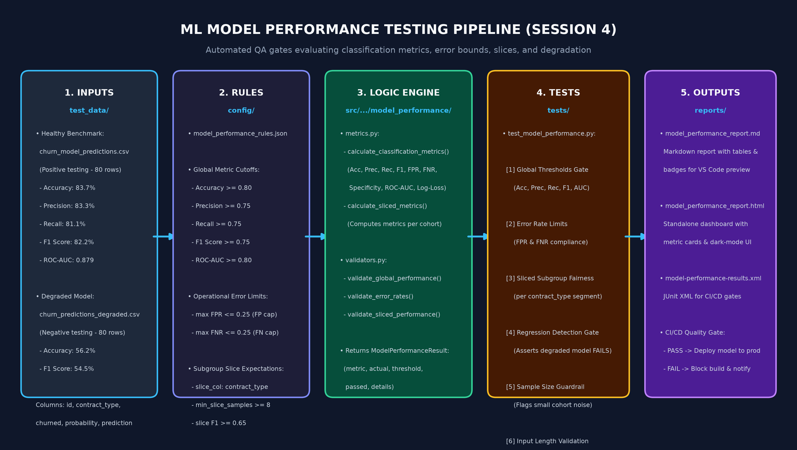

# ML Model Performance Testing

A production-style QA validation module for evaluating machine learning model predictions, ensuring classification accuracy, operational error compliance, fairness across subgroup slices, and automated regression detection.

---

## Architecture & Workflow

The Model Performance testing pipeline processes predictions across 5 programmatic stages:



1. **Inputs:**
   - **Healthy Model Benchmark:** [`test_data/churn_model_predictions.csv`](../../test_data/churn_model_predictions.csv) (Accuracy: 83.75%, F1: 82.19%).
   - **Degraded Model Simulation:** [`test_data/churn_model_predictions_degraded.csv`](../../test_data/churn_model_predictions_degraded.csv) (Accuracy: 56.25%, F1: 54.55%).
2. **Rules:** Threshold cutoffs and error caps from [`config/model_performance_rules.json`](../../config/model_performance_rules.json).
3. **Logic:**
   - Calculation engine: [`src/ai_observability_qa/model_performance/metrics.py`](../../src/ai_observability_qa/model_performance/metrics.py)
   - Quality gates: [`src/ai_observability_qa/model_performance/validators.py`](../../src/ai_observability_qa/model_performance/validators.py)
4. **Tests:** Automated test suite in [`tests/test_model_performance.py`](../../tests/test_model_performance.py).
5. **Outputs:**
   - Visual dashboard: [`reports/model_performance_report.html`](../../reports/model_performance_report.html)
   - Markdown summary: [`reports/model_performance_report.md`](../../reports/model_performance_report.md)
   - Machine-readable XML: [`reports/model-performance-results.xml`](../../reports/model-performance-results.xml)

---

## Configured Rules (`config/model_performance_rules.json`)

```json
{
  "model_name": "customer_churn_classifier",
  "task_type": "binary_classification",
  "min_sample_size": 30,
  "thresholds": {
    "accuracy": { "min": 0.80 },
    "precision": { "min": 0.75 },
    "recall": { "min": 0.75 },
    "f1_score": { "min": 0.75 },
    "roc_auc": { "min": 0.80 }
  },
  "error_rate_limits": {
    "max_false_positive_rate": 0.25,
    "max_false_negative_rate": 0.25
  },
  "slice_evaluations": {
    "slice_column": "contract_type",
    "min_slice_samples": 8,
    "thresholds": {
      "f1_score": { "min": 0.65 },
      "accuracy": { "min": 0.70 }
    }
  }
}
```

---

## Evaluation Logic & Metric Formulas

### 1. Classification Metrics Engine (`metrics.py`)
- `calculate_classification_metrics(y_true, y_pred, y_prob)`: Computes Accuracy, Precision, Recall, F1 Score, Specificity, False Positive Rate (FPR), False Negative Rate (FNR), and ROC-AUC.
- `calculate_sliced_metrics(dataframe, slice_column, ...)`: Evaluates performance across customer segments (e.g. `contract_type`) to uncover hidden subgroup degradation.

### Mathematical Metric Definitions

#### Accuracy
$$\text{Accuracy} = \frac{\text{TP} + \text{TN}}{\text{TP} + \text{TN} + \text{FP} + \text{FN}}$$

#### Precision (Positive Predictive Value)
$$\text{Precision} = \frac{\text{TP}}{\text{TP} + \text{FP}}$$

#### Recall (Sensitivity / True Positive Rate)
$$\text{Recall} = \frac{\text{TP}}{\text{TP} + \text{FN}}$$

#### F1 Score
$$\text{F1 Score} = 2 \times \frac{\text{Precision} \times \text{Recall}}{\text{Precision} + \text{Recall}} = \frac{2\text{TP}}{2\text{TP} + \text{FP} + \text{FN}}$$

#### ROC-AUC (Area Under the Receiver Operating Characteristic Curve)
$$\text{ROC-AUC} = \int_{0}^{1} \text{TPR}(\tau) \, d(\text{FPR}(\tau)) = P\left(\hat{p}_{\text{positive}} > \hat{p}_{\text{negative}}\right)$$

### 2. QA Gate Validators (`validators.py`)
- `validate_global_performance(metrics, threshold_rules)`: Verifies aggregate metrics against configured production minimums.
- `validate_error_rates(metrics, max_fpr, max_fnr)`: Enforces business risk bounds on false alarms (FPR) and missed events (FNR).
- `validate_sliced_performance(...)`: Ensures fairness across subgroups and flags slices with insufficient sample size ($< 8$ samples).

---

## Test Datasets: Why Both Files Are Needed

In AI/ML QA, test suites must evaluate both acceptance and failure-catching behavior:

| Dataset | QA Role | Accuracy | F1 Score | QA Gate Status |
| :--- | :--- | :---: | :---: | :---: |
| `churn_model_predictions.csv` | **Positive Testing (Happy Path):** Healthy baseline model meeting all production thresholds ($\ge 80\%$ accuracy, $\ge 75\%$ F1). | **83.75%** | **82.19%** | **PASSED** |
| `churn_model_predictions_degraded.csv` | **Negative Testing (Quality Gate Verification):** Regressed model simulating performance collapse to ensure QA gates actively catch failures. | **56.25%** | **54.55%** | **FAILED** (Caught by `test_degraded_model_fails_performance_gate`) |

---

## Contract Violations & Invalid Predictions (e.g. `prediction = 2`)

If an unexpected label (such as `2` in a binary classification problem) is introduced into the predictions dataset:

1. **Metric Engine Crash:** Scikit-learn's binary evaluation methods (`precision_score`, `f1_score`) fail immediately with:
   ```text
   ValueError: Target is multiclass but average='binary'. 
   Please choose another average setting, one of [None, 'micro', 'macro', 'weighted'].
   ```
2. **QA Defense in Depth:**
   - **Layer 1 (Data Quality Gate):** Catch contract violations early using `validate_allowed_values` to verify `prediction ∈ {0, 1}` before calculating metrics.
   - **Layer 2 (Model Performance Gate):** Ensures broken or out-of-contract models cannot slip into production silently.

---

## How to Run Tests & Generate Reports

```bash
# Run model performance tests
pytest tests/test_model_performance.py

# Generate HTML report
pytest tests/test_model_performance.py --html=reports/model_performance_pytest_report.html --self-contained-html

# Generate JUnit XML report
python -m pytest tests/test_model_performance.py --junitxml=reports/model-performance-results.xml
```

### Viewing Generated Reports

- **Markdown Report:** Open [`reports/model_performance_report.md`](../../reports/model_performance_report.md) in VS Code (`Ctrl + Shift + V`).
- **HTML Dashboard:** Open [`reports/model_performance_report.html`](../../reports/model_performance_report.html) in your browser.

